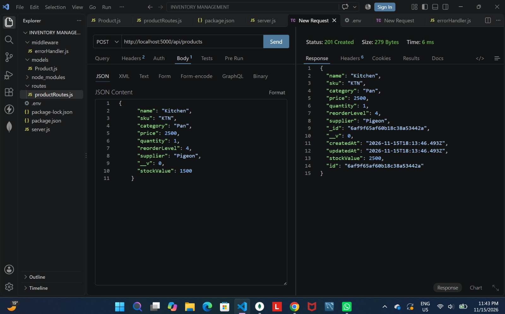
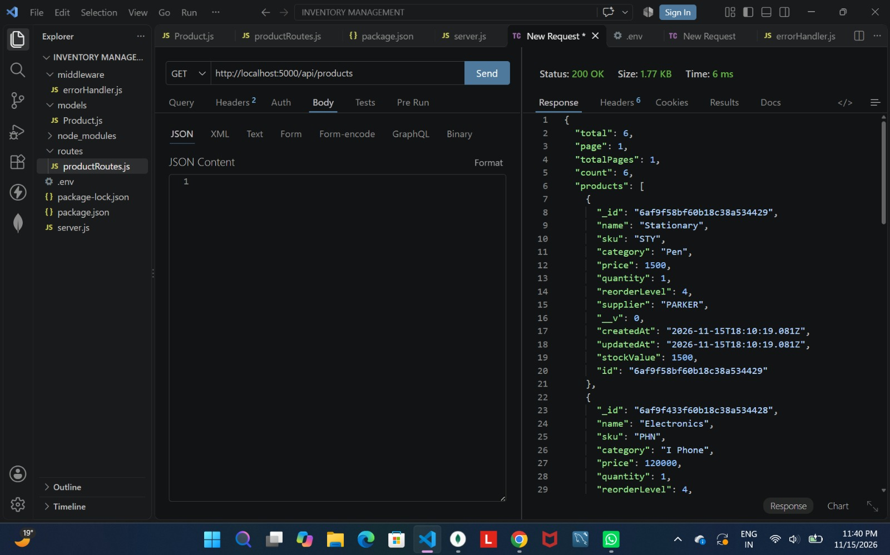
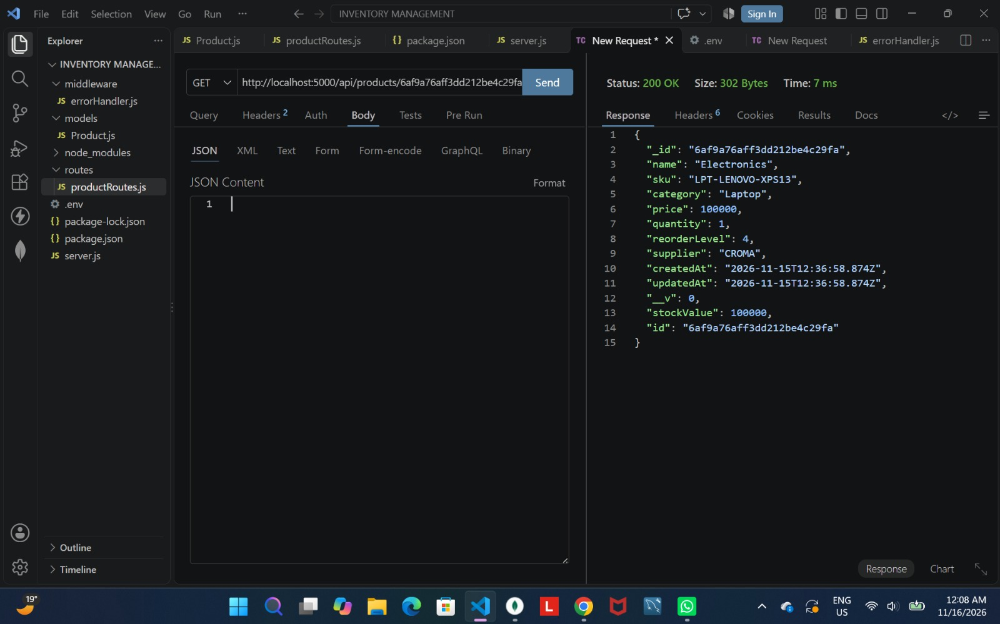
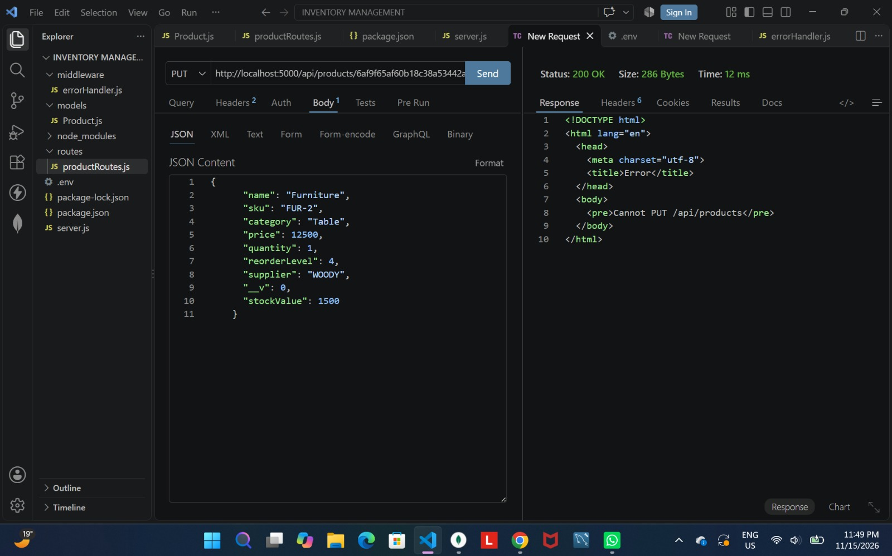
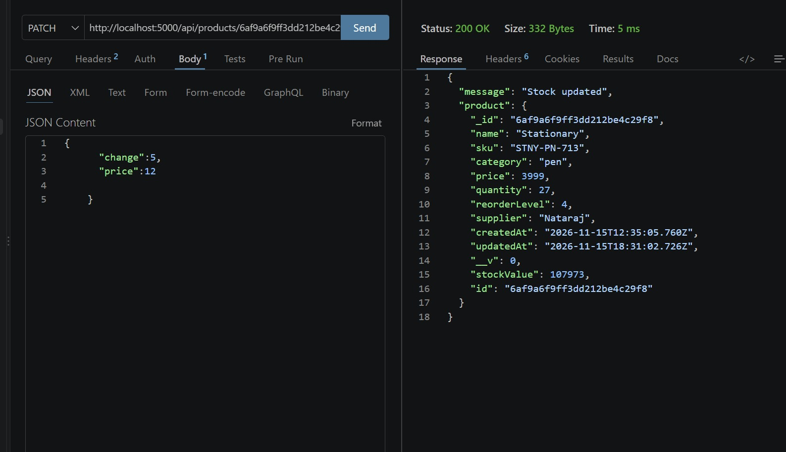
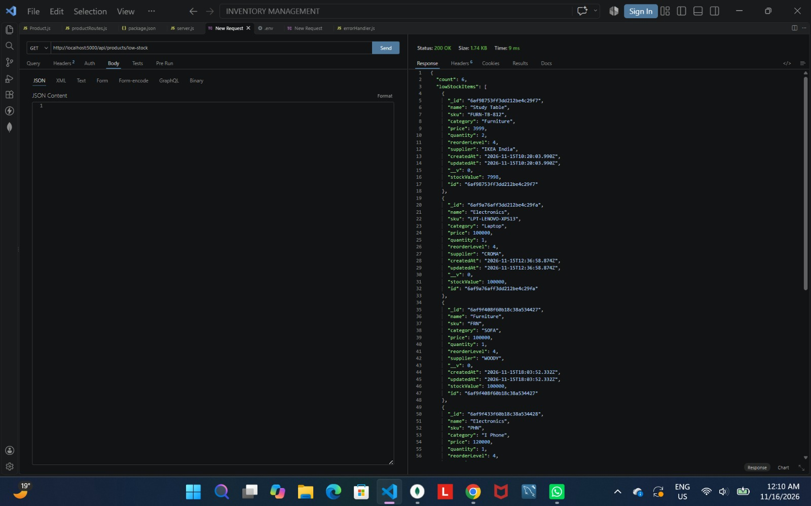
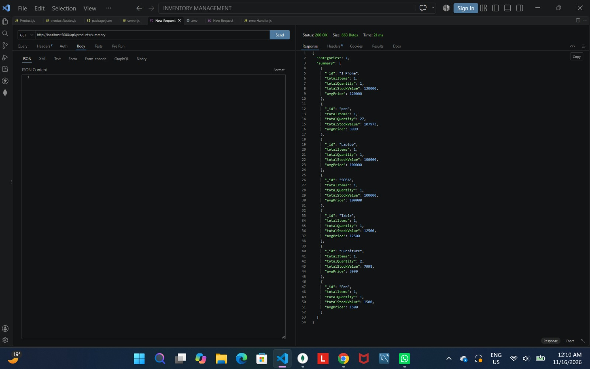

# Inventory and Data Management System

A REST API built with Node.js, Express.js, MongoDB and Mongoose.

## Setup

1. `npm install`

2. Create a `.env` file:

```env
PORT=5000
MONGO_URI=mongodb://127.0.0.1:27017/inventory_db
```

3. `node server.js`

## API Endpoints

| Method | URL | Purpose |
|:---:|---|---|
| POST | `/api/products` | Create product |
| GET | `/api/products` | List with filter, sort, pagination |
| GET | `/api/products/:id` | Get single product |
| PUT | `/api/products/:id` | Update product |
| PATCH | `/api/products/:id/stock` | Restock or sale |
| DELETE | `/api/products/:id` | Delete product |
| GET | `/api/products/low-stock` | Low-stock report |
| GET | `/api/products/summary` | Category-wise summary |


## THUNDER CLIENT SCREENSHOT

### CREATE PRODUCT -> POST


### GET ALL POST


### GET SINGLE PRODUCT


### UPDATE PRODUCT


### STOCK ADJUSTMENT -> PATCH


### LOW STOCK -> GET


### SUMMARY -> GET

